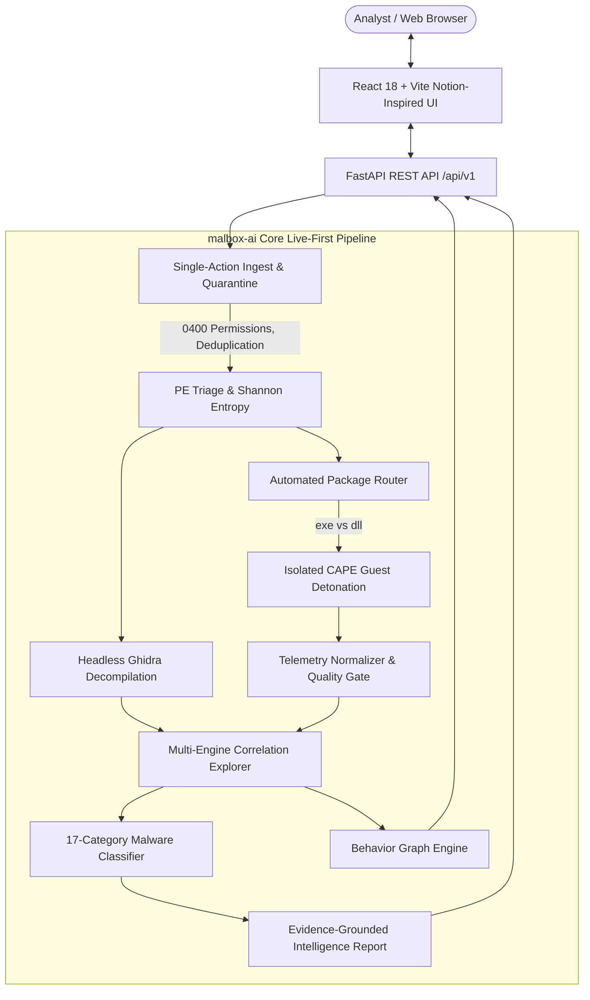

# malbox-ai — Live-First Suspicious File Analysis & Behavioral Intelligence Platform

[](https://python.org)
[](https://fastapi.tiangolo.com)
[](https://react.dev)
[](https://www.typescriptlang.org)
[](https://js.cytoscape.org)
[]()

> **malbox-ai** is a production live-first suspicious file analysis platform comparable in purpose to VirusTotal and Hybrid Analysis. It provides automated static decompilation (Ghidra Headless), isolated dynamic sandbox detonation (CAPE Sandbox v2), multi-engine behavioral correlation, a deterministic 17-category malware taxonomy classifier, interactive Cytoscape.js process lineage graphs, and evidence-grounded threat reporting.

---

## 1. System Architecture



### Key Capabilities
1. **Single-Action Suspicious File Submission:** Drop a suspicious Windows PE executable (.exe, .dll) to trigger automated analysis. No synthetic scenario pickers or artificial demo dropdowns.
2. **Dual-Track Static & Dynamic Analysis:** Automatically coordinates headless Ghidra decompilation inside Bubblewrap sandboxes and live isolated guest VM detonation in CAPE Sandbox.
3. **17-Category Threat Classification Engine:** Evaluates grounded dynamic and static evidence against a deterministic taxonomy (Ransomware, Infostealer, Loader, Wiper, Rootkit, RAT, Backdoor, C2 Agent, etc.) with explicit `CONFIRMED`, `SUSPECTED`, or `UNSUPPORTED` status.
4. **Behavioral Telemetry Quality Contract:** Distinguishes verified benign execution from unmonitored exits or VM crashes. Never declares false "0/100 Clean" scores on incomplete telemetry.
5. **Interactive Behavior Graph & Correlation Explorer:** Full Cytoscape.js process ancestry graph connecting samples, processes, files, registry keys, and network events with HMAC-signed trace provenance.
6. **Strict Host Confinement:** Quarantined samples are stored with read-only non-executable permissions (`0400`) and are never executed directly on the host machine.

---

## 2. Quickstart Installation Guide

### Prerequisites
- Linux (Debian, Ubuntu, Kali Linux) / macOS / WSL2
- Python 3.10+ (Tested on Python 3.12 / 3.14)
- Node.js v18+ and npm (Tested on Node v20 / v24)
- CAPE Sandbox v2 (optional for live guest detonation; static analysis runs standalone)

### One-Command Setup & Launch
```bash
git clone https://github.com/DangGPhuc/malbox.git
cd malbox
./malbox doctor
./malbox doctor --smoke-test
./malbox start
```
- `./malbox doctor`: Checks OS, Python, Node/npm, resources, ports, `.env` safety (`0600`), `.malbox`/`quarantine` directories (`0700`), `.venv`, frontend build, database schema, and CAPE readiness.
- `./malbox doctor --smoke-test`: Runs an isolated temporary-directory intake smoke test verifying hashing, 0400 quarantine permissions, preflight triage, and DB persistence without executing malware.
- `./malbox start`: Starts FastAPI backend (`http://127.0.0.1:8000`) and React/Vite UI (`http://127.0.0.1:5173`).
- `./malbox status` / `./malbox stop`: Monitors process ownership (`proc_start_time`, command signature, OS PGID) and gracefully stops services.

For full CLI diagnostics and options, see [docs/DOCTOR_GUIDE.md](docs/DOCTOR_GUIDE.md).

---

## 3. End-to-End Analysis Workflow

1. Open `http://localhost:5173` in your browser.
2. Navigate to **Submit File** (`#submit`).
3. Drag and drop a suspicious Windows binary (.exe or .dll):
   - *Intake & Quarantine:* Sample is hashed (SHA-256), quarantined at `0400`, and PE metadata is extracted.
   - *Pipeline Capabilities:* Static Ghidra extraction, CAPE isolated detonation, multi-engine correlation, and 17-category classification.
4. Enter your operator security token (`MALBOX_OPERATOR_TOKEN`), check the authorization confirmation, and click **Analyze File**.
5. Observe the automated analysis state machine in the **Workspace**:
   - `PREFLIGHT` $\rightarrow$ `PLANNED` $\rightarrow$ `QUEUED` $\rightarrow$ `RUNNING` $\rightarrow$ `COLLECTING` $\rightarrow$ `NORMALIZING` $\rightarrow$ `CORRELATING` $\rightarrow$ `SCORING` $\rightarrow$ `REPORTING` $\rightarrow$ `COMPLETED`.
6. Inspect the **Behavior Graph** to explore process lineage (`sample.exe` $\rightarrow$ child processes), file modifications, and network connections.
7. Click **Intelligence Report** to view:
   - Malware Category Classification (`CONFIRMED` / `SUSPECTED` categories with supporting evidence).
   - Executive Threat Summary & MITRE ATT&CK technique mapping.
   - Static-Dynamic Correlation Explorer.
   - Export options: Standalone HTML or JSON.

---

## 4. API Endpoints Contract

| Method | Endpoint | Description |
| :--- | :--- | :--- |
| `GET` | `/api/v1/health` | Service health, live mode status, and backend readiness |
| `POST` | `/api/v1/samples` | Upload PE executable for quarantine & static triage |
| `GET` | `/api/v1/samples/{id}` | Retrieve sample metadata and PE headers |
| `POST` | `/api/v1/analyses` | Initiate automated analysis pipeline |
| `GET` | `/api/v1/analyses` | List recent analysis jobs with risk metrics and classification |
| `GET` | `/api/v1/analyses/{id}` | Detailed analysis task lifecycle status |
| `GET` | `/api/v1/analyses/{id}/events` | Filtered and paginated normalized telemetry |
| `GET` | `/api/v1/analyses/{id}/process-tree`| Reconstructed process ancestry hierarchy |
| `GET` | `/api/v1/analyses/{id}/graph` | Cytoscape-compatible interactive behavior graph |
| `GET` | `/api/v1/analyses/{id}/findings` | Behavioral findings and MITRE ATT&CK techniques |
| `GET` | `/api/v1/analyses/{id}/report` | Structured JSON forensic intelligence report with malware classification |
| `GET` | `/api/v1/analyses/{id}/report/html`| Downloadable standalone HTML report with embedded classification |
| `GET` | `/api/v1/analyses/{id}/artifacts` | Downloadable forensic artifacts (PCAP, memory dumps) |

---

## 5. Security Gates & Host Isolation

- **Zero Host Execution:** Executables are never executed via `subprocess` or host shell commands. Dynamic detonation occurs exclusively inside isolated CAPE guest VMs on host-only networks.
- **Quarantine Permissions:** Quarantined samples are set to non-executable, read-only (`0400`) in private data storage.
- **Operator Token Boundary:** Live detonations require an explicit high-entropy token (`MALBOX_OPERATOR_TOKEN` via `X-Operator-Token` header) and fail closed if unconfigured.
- **Bounded Telemetry Ceilings:** Reports are capped at 50 MB and artifact streams at 100 MB to prevent host memory exhaustion.
- **Prompt-Injection Defense:** Untrusted strings from binaries are sanitized and stripped of prompt injection patterns before inclusion in AI report generation contexts.

---

## 6. Verification & Test Suite

Run the full automated test suite:
```bash
# Doctor CLI checks & safe intake smoke test
./malbox doctor --check
./malbox doctor --smoke-test

# Backend test suite (171 passed, 1 skipped)
.venv/bin/pytest backend/tests/ -v

# Frontend test suite (47 passed)
npm --prefix frontend test -- --run
npm --prefix frontend run typecheck
npm --prefix frontend run build
```

Test coverage across **218 automated tests**:
- Single-action file submission and quarantine verification
- Automated package routing (`dll` vs `exe`) and CAPE API v2 polling lifecycle
- Headless Ghidra decompilation inside Bubblewrap sandboxes
- 17-category malware classification engine and multi-label detection
- Contextual detection rules and telemetry completeness quality gates
- Process tree PID reuse resilience and Cytoscape.js behavior graph
- Multi-engine static/dynamic correlation with HMAC trace signing
- Safe intake smoke test and Doctor CLI portability diagnostics
