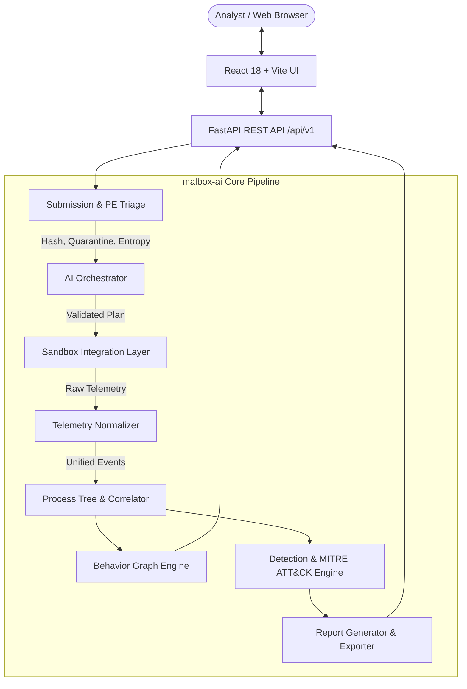

# malbox-ai — AI-Driven Dynamic Malware Analysis & Behavioral Intelligence Platform

[](https://python.org)
[](https://fastapi.tiangolo.com)
[](https://react.dev)
[](https://www.typescriptlang.org)
[](https://js.cytoscape.org)
[]()

> **malbox-ai** is an academic dynamic malware analysis platform inspired by the workflows of VirusTotal and Hybrid Analysis. It provides evidence-grounded dynamic detonation, AI-orchestrated analysis planning, interactive behavioral relationship graph modeling, deterministic MITRE ATT&CK mapping, and structured forensic reporting.

---

## 1. System Architecture



### Key Differentiators
1. **Interactive AI Orchestration:** AI actively participates in preflight planning (selecting profiles, setting bounded execution durations, focusing telemetry) and post-execution gap evaluation.
2. **Deterministic Policy Final Authority:** A strict rule-based policy engine validates every AI proposal against an allowlist before execution. Host shell commands and arbitrary execution are strictly rejected.
3. **Dual Sandbox Integration:**
   - **ReplaySandboxBackend:** High-fidelity, synthetic offline replay engine for zero-risk testing, rapid development, and evaluation.
   - **CapeSandboxBackend:** Official CAPE Sandbox v2 REST API client ready for live cluster deployment.
4. **Interactive Behavior Graph:** Full Cytoscape.js property graph connecting samples, processes, files, registry keys, network endpoints, and findings with supporting event provenance.
5. **Strict Host Isolation:** Uploaded samples are quarantined with read-only permissions (`0400`) and never executed on the host.

---

## 2. Quickstart Installation Guide

### Prerequisites
- Linux / macOS / WSL2
- Python 3.10+ (Tested on Python 3.12 / 3.14)
- Node.js v18+ and npm (Tested on Node v20 / v24)

### One-Command Setup & Launch (Recommended)
```bash
git clone https://github.com/DangGPhuc/malbox.git
cd malbox
./malbox doctor
./malbox doctor --smoke-test
./malbox start
```
- `./malbox doctor`: Checks OS, Python, Node/npm, resources, ports, `.env` safety (`0600`), `.malbox`/`quarantine` (`0700`), `.venv`, frontend deps, database schema, and replay fixtures, then safely sets up Replay Mode without modifying user secrets or running `sudo`.
- `./malbox doctor --smoke-test`: Runs an isolated temporary-directory Replay E2E test confirming pipeline completion and evidence provenance without altering user `data/`.
- `./malbox start`: Starts FastAPI backend (default `http://127.0.0.1:8000`) and React/Vite UI (default `http://127.0.0.1:5173`) in safe Replay Mode, keeping custom `MALBOX_PORT` and Vite `/api` proxy targets synchronized.
- `./malbox status` / `./malbox stop`: Verifies managed OS process ownership (`proc_start_time`, command signature, live OS PGID) and gracefully stops services.

For `--check`, `--repair`, `--smoke-test`, `--json`, custom ports, and Kali Linux evaluation steps, see [docs/DOCTOR_GUIDE.md](docs/DOCTOR_GUIDE.md).

### Manual Setup (Optional / Foreground Launchers)
```bash
python3 -m venv .venv
source .venv/bin/activate
pip install -e "backend[dev]"
cd frontend && npm ci && cd ..

# In terminal 1 & 2 (existing launcher scripts preserved):
./scripts/run_backend.sh
./scripts/run_frontend.sh
```
*API Swagger Documentation:* `http://127.0.0.1:8000/docs` | *Web Dashboard:* `http://127.0.0.1:5173`

---

## 3. End-to-End Walkthrough Demo Scenario

To demonstrate the platform during an academic presentation or evaluation:

1. Open `http://localhost:5173` in your browser.
2. Click **Submit Executable** in the top navigation.
3. Under **Instant Replay Scenarios**, click **WannaCry Ransomware Scenario**.
   - *Static Triage:* Notice the automatic extraction of SHA-256, Shannon entropy calculation, section breakdown, and PE characteristics.
4. Click **Start Dynamic Analysis Workflow**.
5. Observe the **10-Step State Machine** in the **Analysis Workspace**:
   - `PREFLIGHT` → `PLANNED` → `QUEUED` → `RUNNING` → `COLLECTING` → `NORMALIZING` → `CORRELATING` → `SCORING` → `REPORTING` → `COMPLETED`.
6. Inspect the **AI Orchestration Card** to view:
   - AI proposed profile and timeout.
   - Policy Validator allowlist check (`ALLOWED` or `MODIFIED`).
7. Click **Behavior Graph** to interactively explore the process lineage (`sample.exe` → `cmd.exe` → `vssadmin.exe delete shadows`), file encryption bursts, and registry persistence keys.
8. Click **Full Intelligence Report** to view:
   - Executive Threat Summary.
   - Explainable Risk Score (`100/100 MALICIOUS`).
   - MITRE ATT&CK Technique Mappings (`T1490`, `T1486`, `T1547.001`, `T1046`).
   - Extracted IOCs (Domains, IPs, Persistence Keys).
   - Click **Standalone HTML** or **Export JSON** to export reports.

---

## 4. API Endpoints Contract

| Method | Endpoint | Description |
| :--- | :--- | :--- |
| `GET` | `/api/v1/health` | Service health, live mode status, and backend readiness |
| `POST` | `/api/v1/samples` | Upload PE executable for quarantine & static triage |
| `GET` | `/api/v1/samples/{id}` | Retrieve sample metadata and PE headers |
| `POST` | `/api/v1/analyses` | Initiate dynamic analysis state machine |
| `GET` | `/api/v1/analyses` | List recent analysis jobs with risk metrics |
| `GET` | `/api/v1/analyses/{id}` | Detailed analysis task lifecycle status |
| `GET` | `/api/v1/analyses/{id}/events` | Filtered and paginated normalized telemetry |
| `GET` | `/api/v1/analyses/{id}/process-tree`| Reconstructed process ancestry hierarchy |
| `GET` | `/api/v1/analyses/{id}/graph` | Cytoscape-compatible interactive behavior graph |
| `GET` | `/api/v1/analyses/{id}/findings` | Behavioral findings and MITRE ATT&CK techniques |
| `GET` | `/api/v1/analyses/{id}/orchestration`| AI orchestration audit trail and policy logs |
| `GET` | `/api/v1/analyses/{id}/report` | Structured JSON forensic intelligence report |
| `GET` | `/api/v1/analyses/{id}/report/html`| Downloadable standalone dark-theme HTML report |
| `GET` | `/api/v1/analyses/{id}/artifacts` | Downloadable forensic artifacts (PCAP, dumps) |

---

## 5. Security Gates & Host Isolation

- **Zero Host Detonation:** Executable binaries are never executed via `subprocess` or shell commands on the host machine.
- **Quarantine Permissions:** Quarantined samples are set to non-executable, read-only (`0400`) in private data storage.
- **Prompt-Injection Defense:** All untrusted strings (command-lines, registry keys, URLs) are sanitized and stripped of prompt injection patterns before inclusion in AI context.
- **Disabled Live Detonation by Default:** Live mode requires an explicit environment flag (`MALBOX_LIVE_MODE_ENABLED=true`) and per-job analyst signoff.

---

## 6. Verification & Test Suite

Run the full automated test suite sequentially:
```bash
./malbox doctor --check
.venv/bin/pytest backend/tests -v
```

Test coverage across **67 automated tests**:
- Bootstrap CLI (`malbox doctor`, `--check`, `--repair`, `--smoke-test`, `--json`, strict OS process ownership, stale/reused PID & PGID defenses, custom port/Vite proxy validation, `0600`/`0700` permissions, secret preservation)
- Static PE header & Shannon entropy triage & SHA-256 deduplication
- End-to-end Replay pipeline for WannaCry & RedLine scenarios (scenario contract, provenance, artifacts)
- AI orchestration planning, real/fallback LLM provider tracking, & policy allowlist enforcement
- Live execution safety gate, fail-closed `MALBOX_OPERATOR_TOKEN` auth, & worker concurrency=1
- Process tree PID reuse / out-of-order resilience & evidence-grounded Cytoscape behavior graph
- CAPE Sandbox v2 API adapter error recovery & normalization

