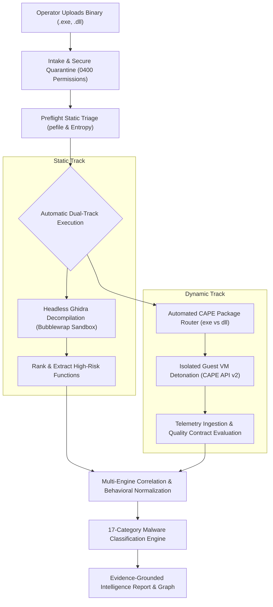

# Live-First Suspicious File Analysis Architecture

**Document Reference:** `docs/architecture/live-first-analysis.md`  
**Applies to:** Malbox-AI v0.2.2+  
**Platform Classification:** Production Live Suspicious File Analysis Platform  

---

## 1. Executive Summary & Product Direction Pivot

Malbox is a live-first suspicious Windows PE binary analysis platform designed for forensic analysts, SOC teams, and reverse engineers. Similar in purpose to VirusTotal and Hybrid Analysis, Malbox is **not a malware simulation or synthetic replay demo**. 

In Malbox v0.2.2+, all synthetic scenario dropdowns, WannaCry/RedLine replay pickers, and artificial demo wizards have been completely removed from the production user experience. The workflow is streamlined to:

$$\text{UPLOAD SUSPICIOUS FILE} \longrightarrow \text{AUTOMATIC DUAL PIPELINE} \longrightarrow \text{EVIDENCE-GROUNDED MALWARE REPORT}$$

Historical replay records created during testing remain accessible in the database for historical auditing, but are strictly labeled with `Synthetic Replay` badges and excluded from active production threat statistics.

---

## 2. End-to-End Analysis Workflow

### Stage 1: Intake, Quarantine & Deduplication
- Files are ingested via the single-action upload endpoint (`/api/v1/samples`).
- Binaries are immediately written to `MALBOX_QUARANTINE_DIR` with strict `0400` read-only permissions.
- Cryptographic hashes (SHA-256, SHA-1, MD5) and file size are computed in streaming chunks.
- If the binary is already known, the existing sample record is returned without duplicating storage.

### Stage 2: Preflight PE Triage
- Fast in-memory inspection via `pefile` extracts:
  * Overall Shannon entropy (0.0 to 8.0) and section-level entropy
  * PE headers (Machine Type, Subsystem, Image Base, Entry Point, Compile Time)
  * Imported DLLs and exported symbols
  * Heuristic packing indicators (e.g., high entropy in `.text` section, non-standard section names)

### Stage 3: Headless Ghidra Static Decompilation
- Run under strict OS containment (`bwrap` sandbox, memory limit, timeout limits).
- Analyzes function control flow, call graphs, and cross-references.
- Ranks functions by heuristic risk (crypto API calls, process injection imports, evasion techniques).
- Decompiles top-ranked suspicious functions without executing binary code.

### Stage 4: Automated CAPE Sandbox Dynamic Detonation
- Pipeline worker inspects the PE structure:
  * If `.dll` extension or PE characteristics indicate DLL $\rightarrow$ routes to CAPE package `dll`.
  * Otherwise $\rightarrow$ routes to CAPE package `exe`.
- Submits sample to `/apiv2/tasks/create/file/` with explicit operator authorization.
- Polls task status through `pending` $\rightarrow$ `running` $\rightarrow$ `completed` $\rightarrow$ `reported`.
- Telemetry quality contracts evaluate completeness: distinguishes clean execution from guest crashes or unmonitored exits.

### Stage 5: Multi-Engine Correlation & Evidence Grounding
- Correlates static functions with dynamic runtime observations:
  * Static API import vs Dynamic API call trace
  * Static string references vs Dynamic network C2 domains / registry keys
- HMAC-signed trace key verification (`MALBOX_TRACE_AUTH_KEY`) prevents trace spoofing.

### Stage 6: 17-Category Threat Classification Engine
- Evaluates grounded static and dynamic findings against the deterministic taxonomy:
  * Ransomware, Infostealer, Loader, Backdoor, Rootkit, Wiper, RAT, C2 Agent, Miner, Adware, Spyware, Worm, Keylogger, Downloader, Exploit Payload.
  * Correctly flags unsupported categories (`phishing`, `android_rat`) as `UNSUPPORTED` for Windows PE binaries.
- Calculates deterministic confidence scores and supporting evidence references.

### Stage 7: Evidence-Grounded AI Intelligence Report
- Generates MITRE ATT&CK technique mapping.
- Formulates analytical claims tied strictly to verified evidence IDs (`ev-*`, `art-*`, `fn-*`).
- Produces interactive Cytoscape behavioral process tree and visual correlation explorer.

---

## 3. Host Confinement & Security Guarantees

1. **Host Non-Execution:** Binaries are **never executed directly on the host system**. Dynamic detonation occurs exclusively inside isolated CAPE guest virtual machines on host-only networks (`vboxnet0` or KVM bridge).
2. **Quarantine Protection:** All quarantined samples are stored as raw `.bin` files with `chmod 0400` (read-only, non-executable).
3. **Operator Authentication Boundary:** Live detonation requires an explicit operator token passed via `X-Operator-Token` matching `MALBOX_OPERATOR_TOKEN`. Live detonation fails closed if unconfigured. Secrets are kept strictly in transient memory in the UI and never persisted in `localStorage` or `sessionStorage`.
4. **Mandatory Confinement Gate (`verify_cape_confinement`):** A configured route name in `.env` (e.g. `route="drop"`) is **never** accepted as proof of isolation. Detonation requires an unexpired operator attestation (`cape_isolation_attestation.json`) signed by the operator, matching the selected machine and safe route (`drop`, `none`, or `isolated`). Missing machines metadata or missing attestation blocks detonation fail-closed.
5. **Ghidra Process Termination & Sequential Synchronization:** The analysis pipeline awaits completion of Ghidra headless static analysis before CAPE dispatch. If Ghidra exceeds its timeout, `cancel_active(wait_seconds)` terminates the process group. If the worker process remains active, CAPE dynamic detonation is strictly blocked and the analysis transitions to `FAILED`. Static analysis status is accurately recorded as `TIMED_OUT`, `FAILED`, `UNAVAILABLE`, or `PARTIAL`.
6. **Bounded Telemetry Streaming & Absolute Monotonic Deadlines:** Polling, report retrieval, and artifact downloads operate under a strict monotonic deadline that is never artificially extended. Streaming response bodies are bounded to 50 MB (`MAX_REPORT_BYTES`) and 100 MB (`MAX_ARTIFACT_BYTES`). The host checks for at least 200 MB free disk space before writing artifacts, and partially transferred `.tmp` files are immediately deleted on error or timeout.
7. **Bubblewrap Static Sandboxing:** Headless Ghidra decompiler runs under `bwrap` with unshared network, IPC, and PID namespaces.

---

## 4. Historical Replay Deprecation & Backward Compatibility

- **Production Disabled:** `MALBOX_ALLOW_SYNTHETIC_REPLAY=false` by default. Requests to create new replay analyses are rejected with HTTP 400.
- **Audit Preservation:** Existing replay records in the database remain fully viewable. Their provenance disclaimers explicitly read `SYNTHETIC REPLAY — UPLOADED BINARY NOT EXECUTED`.
- **Dashboard Isolation:** The Dashboard excludes historical replay analyses from active threat metrics (`maliciousCount`, `suspiciousCount`, `lowCount`, `cleanCount`). Replay items are labeled with a distinct `Synthetic Replay` badge.
