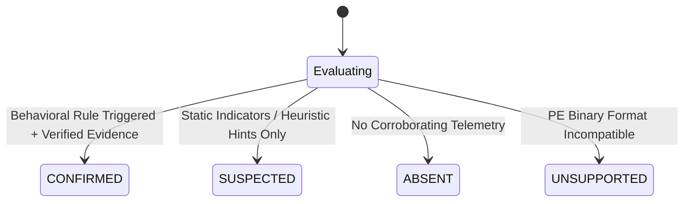

# Malware Classification & Threat Taxonomy Engine

**Document Reference:** `docs/architecture/malware-classification.md`  
**Applies to:** Malbox-AI v0.2.2+  
**Taxonomy Version:** `1.0`  
**Classifier Engine Version:** `1.0.0`  

---

## 1. Overview & Objectives

The Malbox Malware Classification Engine provides deterministic, evidence-grounded threat categorization for Windows PE binaries. Instead of relying on opaque or speculative generative AI guesses, the classification engine analyzes verified dynamic behavior events, static imports, Ghidra decompilation facts, and multi-engine correlations.

Every classification decision is accompanied by:
- Concrete evidence identifiers (`evidence_ids`, `supporting_static_function_ids`, `supporting_dynamic_event_ids`, `supporting_artifact_ids`)
- A deterministic confidence score (0.0 to 1.0)
- Explicit rationale and contradictory evidence tracking
- Documented limitations based on telemetry quality

---

## 2. 17-Category Malware Taxonomy

| Category ID | Display Name | Category Type | PE Support Status | Primary Detection Indicators |
| :--- | :--- | :--- | :--- | :--- |
| `ransomware` | Ransomware | Malware | Supported | Shadow copy deletion (`vssadmin delete shadows`), mass file renaming, encryption burst, ransom note drops |
| `infostealer` | Infostealer | Malware | Supported | Browser credential vault access, DPAPI decryption, crypto wallet searches, FTP/email credential theft |
| `loader` | Loader / Dropper | Malware | Supported | Embedded PE extraction, drop executable to `%TEMP%`/`%APPDATA%`, stealth execution (`regsvr32`, `rundll32`) |
| `backdoor` | Backdoor | Malware | Supported | Covert network listener, reverse shell spawn, remote command execution capabilities |
| `rootkit` | Rootkit | Malware | Supported | Kernel driver installation (`.sys`), direct kernel object manipulation, SSDT hooking, hidden processes |
| `wiper` | Wiper | Malware | Supported | Volume/partition overwrite, MBR destruction, zeroing disk sectors without ransom demands |
| `rat` | Remote Access Trojan | Malware | Supported | Screen capture, microphone/webcam recording, remote interactive desktop control, file exfiltration |
| `c2_agent` | C2 Agent | Malware | Supported | Periodic beaconing, encoded HTTP/DNS command polling, encrypted command stream handling |
| `miner` | Cryptominer | Malware | Supported | High sustained CPU usage, Stratum mining protocol traffic, known mining pool connections |
| `adware` | Adware | PUA | Supported | Browser injection, unauthorized popups, desktop shortcut creation to ad URLs |
| `spyware` | Spyware | Malware | Supported | User activity tracking, browser history scraping, application monitoring, telemetry exfiltration |
| `worm` | Network Worm | Malware | Supported | Port scanning (SMB 445, RDP 3389), self-propagation to network shares, lateral movement |
| `keylogger` | Keylogger | Malware | Supported | `SetWindowsHookEx` (WH_KEYBOARD), `GetAsyncKeyState` polling, clipboard monitoring |
| `downloader` | Downloader | Malware | Supported | Staged payload download (`URLDownloadToFile`, PowerShell `Invoke-WebRequest`), secondary execution |
| `exploit_payload`| Exploit Payload | Malware | Supported | Memory corruption exploitation, shellcode staging, ROP chain execution |
| `phishing` | Phishing Document | Social Engineering | **Unsupported for PE** | Evaluated as `UNSUPPORTED` (relevant for Office macros, HTML/HTA, emails, not Windows PE) |
| `android_rat` | Android RAT | Mobile Malware | **Unsupported for PE** | Evaluated as `UNSUPPORTED` (relevant for Android APK/DEX payloads, not Windows PE) |

---

## 3. Classification Assessment Lifecycle

Each taxonomy category is independently evaluated and assigned one of four statuses:

1. **`CONFIRMED`:** Direct corroborating behavioral findings and dynamic telemetry events observed during execution (e.g. shadow copy deletion confirmed by dynamic process event). Confidence $\ge 0.80$.
2. **`SUSPECTED`:** Static imports, strings, or suspicious heuristics match the category pattern, but runtime execution did not trigger dynamic confirmation (e.g. import of crypto APIs and encryption strings without an observed file modification burst). Confidence between $0.40$ and $0.79$.
3. **`ABSENT`:** No static or dynamic evidence detected for this category.
4. **`UNSUPPORTED`:** Binary format is architecturally incompatible with the threat category (e.g. `phishing` or `android_rat` on a Windows PE executable).

---

## 4. Overall Classification Statuses

The top-level classification result (`MalwareClassificationResult`) evaluates to one of the following states:

- **`CLASSIFIED`:** At least one category achieved `CONFIRMED` or `SUSPECTED` status with supporting evidence.
- **`UNKNOWN`:** The analysis completed successfully with verified full telemetry, but no known threat behaviors or suspicious heuristics matched any category (consistent with benign utilities or novel evasion).
- **`INSUFFICIENT_EVIDENCE`:** The analysis failed, timed out, or telemetry was incomplete (e.g., guest VM crashed, dynamic unmonitored termination). The engine explicitly refuses to declare benign clean status on incomplete telemetry.
- **`UNSUPPORTED`:** Non-executable or unsupported payload architecture.

---

## 5. Multi-Label Classification Rules

Real-world malware frequently exhibits behaviors across multiple categories (e.g., a sample that drops a payload, steals credentials, and encrypts files). 

The engine handles this through primary and secondary category assignments:

1. **Primary Category Selection:**
   - Prioritizes `CONFIRMED` categories over `SUSPECTED` categories.
   - Among equal statuses, prioritizes destructive impact:  
     $\text{Ransomware} > \text{Wiper} > \text{Rootkit} > \text{Infostealer} > \text{RAT} > \text{Backdoor} > \text{Loader}$.
   - Resolves ties using highest confidence score.
2. **Secondary Categories:**
   - Any other categories reaching `CONFIRMED` or `SUSPECTED` status are listed in `secondary_categories`.
   - The UI displays both primary and secondary categories with direct links to corresponding evidence items.
