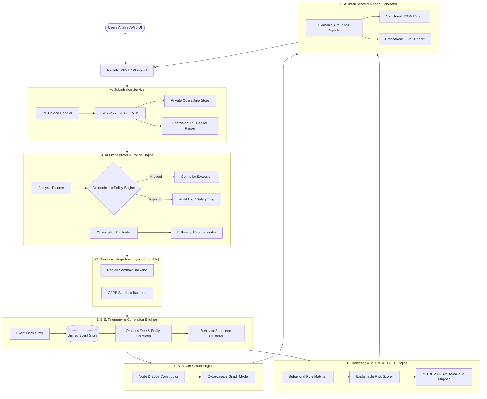

# Architecture Rebuild Plan — malbox-ai

**Project Codename:** `malbox-ai`  
**Role:** Lead Security Software Architect & Engineering Team  
**Date:** November 2026  
**Status:** Approved for Implementation (Phase 0)

---

## 1. Executive Summary & Audit of Existing State

### 1.1 Context and Repository Audit
The target workspace `/home/kali/Documents/malbox` was initialized as a fresh project directory designated for the complete architectural realization of the **AI-Driven Dynamic Malware Analysis and Behavioral Intelligence Platform**. 

An audit of the surrounding environment revealed:
- Background study materials and architectural notes (in `/home/kali/Documents/gourp project/` and related folders) detailing malware lifecycle stages (12 stages), PE file mappings (`CreateFileA`, `CreateFileMappingA`), dynamic analysis report structures, and anti-analysis detection.
- Clean development runtime: Python 3.14.7, Node.js v24.19.0, npm 12.0.2.
- A requirement to establish a reproducible, production-grade academic repository with full version control history, strict safety gates, and zero dependency on uncontained host malware execution.

### 1.2 Migration & Rebuild Decision
We operate on a dedicated rebuild branch: `rebuild/malbox-ai`.
Rather than adopting fragile ad-hoc scripts or unverified legacy wrappers, `malbox-ai` is built from the ground up as a modular, enterprise-quality security system adhering to strict defensive design principles.

---

## 2. System Mission & Core Value Proposition

`malbox-ai` is inspired by the analysis workflows of VirusTotal and Hybrid Analysis, but engineered as an original, transparent, evidence-grounded dynamic analysis platform.

Key differentiators:
1. **Interactive AI Orchestration:** AI does not merely generate a post-hoc summary; it actively evaluates sample metadata during preflight, recommends bounded execution profiles and telemetry focus areas, identifies telemetry gaps, and proposes policy-governed follow-up actions.
2. **Strict Deterministic Policy Enforcement:** All AI recommendations pass through an explicit allowlist and rule-based policy engine before any sandbox interaction occurs. The AI has zero shell access or arbitrary command execution capability.
3. **Pluggable Sandbox Integration:** Built-in dual backend architecture:
   - `ReplaySandboxBackend`: High-fidelity, synthetic, multi-stage telemetry replay for safe, reproducible offline analysis, development, and unit/integration testing.
   - `CapeSandboxBackend`: Strict integration with the official CAPE Sandbox REST API, featuring validation, polling, artifact retrieval, and comprehensive mocked test coverage.
4. **Evidence Provenance & Graph Modeling:** Every behavioral finding, MITRE ATT&CK technique, process node, and IOC is strictly linked to supporting event IDs and source telemetry artifacts. Hypotheses are explicitly distinguished from hard observations.

---

## 3. Logical Architecture & Component Boundaries



### Component Breakdown
1. **Submission Service:** Accepts PE executables, calculates SHA-256, SHA-1, MD5, extracts sections/imports/exports without executing code, dedupes via hash, assigns unique UUID analysis IDs, isolates files in private quarantine.
2. **AI Analysis Orchestrator:** Multi-stage decision engine (Planner, Policy Validator, Controller, Observation Evaluator, Follow-up Decision Engine). Supported decisions: profile selection, duration bounds, artifact capture requests, telemetry gap detection, second pass recommendation.
3. **Sandbox Integration Layer (`SandboxBackend`):** Abstract interface for status check, submission, polling, artifact retrieval, task cancellation. Implements `ReplaySandboxBackend` (using realistic mock fixtures) and `CapeSandboxBackend` (API v2 client with schema validation).
4. **Dynamic Telemetry & Normalizer:** Converts disparate sandbox logs into an immutable, unified event stream: processes, command lines, file ops, registry keys, network DNS/HTTP/TCP, API calls, persistence indicators.
5. **Correlation Engine:** Assembles parent-child process trees, ties file modifications and network connections back to specific PIDs, extracts IOCs with explicit provenance.
6. **Behavior Graph Engine:** Translates correlations into an interactive directed property graph (`Sample`, `Process`, `File`, `RegistryKey`, `Domain`, `IPAddress`, `Finding`, `Artifact`) with edge types (`EXECUTED_AS`, `SPAWNED`, `CREATED`, `MODIFIED`, `DELETED`, `CONNECTED_TO`, `RESOLVED_TO`, `DROPPED`, `SUPPORTS_FINDING`).
7. **Detection Engine:** Deterministic rule engine for MITRE ATT&CK techniques (e.g., T1059 Command & Scripting, T1547 Registry Run Keys, T1071 App Layer Protocol, T1055 Process Injection, T1486 Data Encrypted for Impact), computing explainable severity (Informational to Critical) and confidence ratings.
8. **AI Reporting Engine:** Produces structured intelligence reports with executive summary, timeline, process tree, ATT&CK matrix, evidence references, and actionable analyst guidance. Deterministic fallbacks ensure full functionality when offline.

---

## 4. State Machine & Task Lifecycle

The analysis lifecycle follows an explicit, audited finite state machine:
```text
UPLOADED
   ↓
PREFLIGHT (PE metadata parsed, static triage)
   ↓
PLANNED (AI analysis plan generated & policy-checked)
   ↓
QUEUED (Enqueued for sandbox execution)
   ↓
RUNNING (Detonation / replay simulation active)
   ↓
COLLECTING (Gathering raw execution artifacts & logs)
   ↓
NORMALIZING (Translating into standardized schema)
   ↓
CORRELATING (Reconstructing process trees & temporal links)
   ↓
SCORING (Evaluating behavioral rules & MITRE ATT&CK mappings)
   ↓
REPORTING (Generating structured AI & deterministic report)
   ↓
COMPLETED
```

Terminal or exceptional states: `FAILED`, `CANCELLED`, `TIMED_OUT`, `BLOCKED_BY_POLICY`.
All state transitions log timestamp, previous state, new state, trigger event, and rationale.

---

## 5. Technology Stack Decisions

| Layer | Choice | Justification |
| :--- | :--- | :--- |
| **Backend Framework** | FastAPI (Python 3.14 compatible) | High-performance async REST, native OpenAPI generation, automatic Pydantic validation |
| **Data Validation** | Pydantic v2 | Strict serialization, schema enforcement, clean error reporting |
| **Database ORM** | SQLAlchemy 2.0 with SQLite | Zero external setup overhead for local demo/academic presentation; portable to PostgreSQL |
| **PE Analysis** | Lightweight pure-Python / `pefile` / custom struct parser | Safely inspect headers, sections, imports without running binaries or launching heavyweight frameworks |
| **AI Integration** | Provider-agnostic client + Mock AI provider | Deterministic offline mode ensures system runs without API keys; pluggable OpenAI/Gemini support |
| **Frontend Framework** | React 18 + TypeScript + Vite | Rapid build times, strict typing, modern reactive state management |
| **Graph Visualization**| Cytoscape.js with dagre / concentric layouts | Industry-standard security graph visualization for process trees and entity relationships |
| **Styling & UI** | Modern Tailwind CSS Dark Theme | Polished, professional dark-mode SOC/malware sandbox visual aesthetic |

---

## 6. Security and Resource Safety Gates

1. **Host Execution Prohibition:** Uploaded PE files are never executed on the host. Quarantined samples have read-only permissions and are stored in isolated paths outside web server roots.
2. **Prompt-Injection Defense:** All sandbox strings, filenames, and registry values are treated as untrusted data inputs. AI prompts strictly sanitize inputs and enforce schema validation on responses.
3. **Deterministic Allowlist:** AI recommendations (e.g., extend timeout, capture memory dump) must be present in a predefined action allowlist and validated by `PolicyValidator` before execution.
4. **Resource Constraints:** In-process single-concurrency bounded worker queue. Sequential task execution prevents CPU/RAM exhaustion.
5. **Safe Live Mode Gate:** Live detonation against external sandboxes is disabled by default (`MALBOX_LIVE_MODE_ENABLED=false`) and requires explicit per-job analyst signoff.

---

## 7. Phased Implementation Roadmap

- [x] **Phase 0: Repository Audit and Safe Rebuild Plan** (Complete)
- [ ] **Phase 1: Foundation and Contracts** (Scaffold backend/frontend, DB models, Pydantic schemas, PE metadata extractor, health check)
- [ ] **Phase 2: Functional Replay Pipeline** (Synthetic ransomware/infostealer fixtures, normalizer, correlator, graph engine, detection rules, deterministic report)
- [ ] **Phase 3: AI-Controlled Orchestration** (Analysis planner, policy engine, mock & live LLM connectors, decision audit trail)
- [ ] **Phase 4: Functional Frontend** (Vite + React UI, Cytoscape graph visualizer, sample submit, live workspace, full report view & export)
- [ ] **Phase 5: CAPE Adapter Readiness** (Official CAPE v2 API adapter, mocked integration tests, failure handling, offline documentation)
- [ ] **Phase 6: Documentation and Quality Gates** (Comprehensive docs, end-to-end tests, walk-through scenarios, BUILD_STATUS.md)
